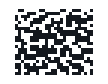

# DN2 WISHES

Custom firmware for the Elektron Digitone II, OS 1.12. Built on
[dn2mk2](https://github.com/De-Pattern/dn2mk2-firmware) by De-Pattern.

- 1.12 support.
- Machines: JUNO, ANALOG (filters SVF, LADR, OTA, DIODE, MS-20), TB-303, PLAITS, SOPHIE, DRONE.
- Paraphonic mode on ANALOG and JUNO (VOICE page, knob B): a chord through one filter.
- Insert effects: FUZZ, TAPE, FOLD, CHOR, WIDE, HARM, FDN8, XDLY, SUB, DIST, GATER,
  RING, JUNO.
- Modulation matrix.
- Voice budget: new notes take the voice of an old one before the DSP runs out of time.
- Seven new LFO waveforms (from dn2mk2).

## Machines

Ours are machine types 50 to 56 in MACHINE SEL; the others come from dn2mk2, grouped by the machine they were ported from.

### Ours

<table>
<tr><td width="60"><picture><source media="(prefers-color-scheme: dark)" srcset="docs/img/icons/machine-juno-dark.png"></picture></td><td><b>JUNO</b></td><td>The Juno-106 voice: DCO with saw, pulse and sub, noise, ladder filter, high-pass. From Optimist.</td></tr>
<tr><td width="60"><picture><source media="(prefers-color-scheme: dark)" srcset="docs/img/icons/machine-analog-dark.png"></picture></td><td><b>ANALOG</b></td><td>Two oscillators, a swarm, hard sync, noise, drive, and five filter models (below). From Optimist (after Leo Kuroshita's eng_analog).</td></tr>
<tr><td width="60"><picture><source media="(prefers-color-scheme: dark)" srcset="docs/img/icons/machine-drone-dark.png"></picture></td><td><b>DRONE</b></td><td>Four coupled sine generators for drones and ambient, with binaural beats. From Optimist, after Caravel's DRONE.</td></tr>
<tr><td width="60"><picture><source media="(prefers-color-scheme: dark)" srcset="docs/img/icons/machine-sophie-dark.png"></picture></td><td><b>SOPHIE</b></td><td>Percussive metal, pipes and kicks. From Schwung Sophie.</td></tr>
<tr><td width="60"><picture><source media="(prefers-color-scheme: dark)" srcset="docs/img/icons/machine-tb-303-dark.png"></picture></td><td><b>TB-303</b></td><td>An acid bass voice (Open303, as Schwung 303 plays it).</td></tr>
<tr><td width="60"><picture><source media="(prefers-color-scheme: dark)" srcset="docs/img/icons/machine-plaits-dark.png"></picture></td><td><b>PLAITS</b></td><td>Mutable Instruments Plaits' engines, chosen by MODL: WS, VA, FM, ADD, SWRM, NOIS, PART, STRG, MDAL, BD, SD, HH.</td></tr>
<tr><td width="60"><picture><source media="(prefers-color-scheme: dark)" srcset="docs/img/icons/machine-drum-dark.png"></picture></td><td><b>DRUM</b></td><td>A synth drum machine; TYPE (page 1, knob H) chooses the drum: KICK, SNAR, CLHH, OPHH, TOM, CLAP, RIDE, CRSH.</td></tr>
</table>

### From the Monomachine

<table>
<tr><td width="60"><picture><source media="(prefers-color-scheme: dark)" srcset="docs/img/icons/machine-sid-6581-dark.png"></picture></td><td><b>SID 6581</b></td><td>The Commodore 64's sound chip. From dn2mk2, ported from the Monomachine's own firmware (SFX-6/60 OS 1.32B), polyphonic.</td></tr>
<tr><td width="60"><picture><source media="(prefers-color-scheme: dark)" srcset="docs/img/icons/machine-dpro-wave-dark.png"></picture></td><td><b>DPRO WAVE</b></td><td>DigiPRO wavetables. From dn2mk2, ported from the Monomachine's own firmware (SFX-6/60 OS 1.32B), polyphonic.</td></tr>
<tr><td width="60"><picture><source media="(prefers-color-scheme: dark)" srcset="docs/img/icons/machine-dpro-ddrw-dark.png"></picture></td><td><b>DPRO DDRW</b></td><td>DigiPRO DDRW. From dn2mk2, ported from the Monomachine's own firmware (SFX-6/60 OS 1.32B), polyphonic.</td></tr>
<tr><td width="60"><picture><source media="(prefers-color-scheme: dark)" srcset="docs/img/icons/machine-dpro-dens-dark.png"></picture></td><td><b>DPRO DENS</b></td><td>DigiPRO DENS. From dn2mk2, ported from the Monomachine's own firmware (SFX-6/60 OS 1.32B), polyphonic.</td></tr>
<tr><td width="60"><picture><source media="(prefers-color-scheme: dark)" srcset="docs/img/icons/machine-vo-6-voice-dark.png"></picture></td><td><b>VO-6</b></td><td>Speech synthesis. From dn2mk2, ported from the Monomachine's own firmware (SFX-6/60 OS 1.32B), polyphonic.</td></tr>
<tr><td width="60"><picture><source media="(prefers-color-scheme: dark)" srcset="docs/img/icons/machine-fmplus-stat-dark.png"></picture></td><td><b>FM+ STAT</b></td><td>Two operators, self feedback. From dn2mk2, ported from the Monomachine's own firmware (SFX-6/60 OS 1.32B), polyphonic.</td></tr>
<tr><td width="60"><picture><source media="(prefers-color-scheme: dark)" srcset="docs/img/icons/machine-fmplus-par-dark.png"></picture></td><td><b>FM+ PAR</b></td><td>Three operators in parallel, each with its own decay. From dn2mk2, ported from the Monomachine's own firmware (SFX-6/60 OS 1.32B), polyphonic.</td></tr>
<tr><td width="60"><picture><source media="(prefers-color-scheme: dark)" srcset="docs/img/icons/machine-fmplus-dyn-dark.png"></picture></td><td><b>FM+ DYN</b></td><td>Two operators with pitch and volume envelopes. From dn2mk2, ported from the Monomachine's own firmware (SFX-6/60 OS 1.32B), polyphonic.</td></tr>
</table>

### From the Machinedrum

<table>
<tr><td width="60"><picture><source media="(prefers-color-scheme: dark)" srcset="docs/img/icons/machine-machinedrum-dark.png"></picture></td><td><b>MACHINEDRUM</b></td><td>The Machinedrum's TRX, EFM, GND and P-I machines (34), chosen by TYPE, with its track effects. From dn2mk2, ported from the Machinedrum's own firmware (UW OS 1.63).</td></tr>
</table>

### From the Digitakt II

<table>
<tr><td width="60"><picture><source media="(prefers-color-scheme: dark)" srcset="docs/img/icons/machine-oneshot-dark.png"></picture></td><td><b>ONESHOT</b></td><td>From dn2mk2, the Digitakt II's sample machine.</td></tr>
<tr><td width="60"><picture><source media="(prefers-color-scheme: dark)" srcset="docs/img/icons/machine-werp-dark.png"></picture></td><td><b>WERP</b></td><td>From dn2mk2, the Digitakt II's sample machine.</td></tr>
<tr><td width="60"><picture><source media="(prefers-color-scheme: dark)" srcset="docs/img/icons/machine-stretch-dark.png"></picture></td><td><b>STRETCH</b></td><td>From dn2mk2, the Digitakt II's sample machine.</td></tr>
<tr><td width="60"><picture><source media="(prefers-color-scheme: dark)" srcset="docs/img/icons/machine-repitch-dark.png"></picture></td><td><b>REPITCH</b></td><td>From dn2mk2, the Digitakt II's sample machine.</td></tr>
<tr><td width="60"><picture><source media="(prefers-color-scheme: dark)" srcset="docs/img/icons/machine-grid-dark.png"></picture></td><td><b>GRID</b></td><td>From dn2mk2, the Digitakt II's sample machine.</td></tr>
<tr><td width="60"><picture><source media="(prefers-color-scheme: dark)" srcset="docs/img/icons/machine-slice-dark.png"></picture></td><td><b>SLICE</b></td><td>From dn2mk2, the Digitakt II's sample machine.</td></tr>
</table>

### From dn2mk2, origin not stated

<table>
<tr><td width="60"><picture><source media="(prefers-color-scheme: dark)" srcset="docs/img/icons/machine-bounce-dark.png"></picture></td><td><b>BOUNCE</b></td><td>FLEX: plays the recorder's buffers. From dn2mk2.</td></tr>
</table>

## FX inserts

Two slots a track: [FX] steps through FX 1/3 (stock), 2/3 (INSERT 1) and 3/3 (INSERT 2). M.SEL picks the effect,
MIX blends it in.

<table>
<tr><td width="60"><picture><source media="(prefers-color-scheme: dark)" srcset="docs/img/icons/fx-chor-dark.png"></picture></td><td><b>CHOR</b></td><td>Chorus, one to four voices.</td></tr>
<tr><td width="60"><picture><source media="(prefers-color-scheme: dark)" srcset="docs/img/icons/fx-dist-dark.png"></picture></td><td><b>DIST</b></td><td>Distortion. From Optimist.</td></tr>
<tr><td width="60"><picture><source media="(prefers-color-scheme: dark)" srcset="docs/img/icons/fx-fdn8-dark.png"></picture></td><td><b>FDN8</b></td><td>Eight-line feedback delay network reverb. From Optimist.</td></tr>
<tr><td width="60"><picture><source media="(prefers-color-scheme: dark)" srcset="docs/img/icons/fx-fold-dark.png"></picture></td><td><b>FOLD</b></td><td>Wavefolder.</td></tr>
<tr><td width="60"><picture><source media="(prefers-color-scheme: dark)" srcset="docs/img/icons/fx-fuzz-dark.png"></picture></td><td><b>FUZZ</b></td><td>Fuzz with a gate.</td></tr>
<tr><td width="60"><picture><source media="(prefers-color-scheme: dark)" srcset="docs/img/icons/fx-gatr-dark.png"></picture></td><td><b>GATR</b></td><td>Rhythmic gate, 16 patterns. From Optimist.</td></tr>
<tr><td width="60"><picture><source media="(prefers-color-scheme: dark)" srcset="docs/img/icons/fx-harm-dark.png"></picture></td><td><b>HARM</b></td><td>Adds harmonics above a frequency.</td></tr>
<tr><td width="60"><picture><source media="(prefers-color-scheme: dark)" srcset="docs/img/icons/fx-juno-dark.png"></picture></td><td><b>JUNO</b></td><td>The Juno-106's BBD chorus, modes I, II, I+II. From Optimist.</td></tr>
<tr><td width="60"><picture><source media="(prefers-color-scheme: dark)" srcset="docs/img/icons/fx-ring-dark.png"></picture></td><td><b>RING</b></td><td>Ring modulator. From Optimist.</td></tr>
<tr><td width="60"><picture><source media="(prefers-color-scheme: dark)" srcset="docs/img/icons/fx-sub-dark.png"></picture></td><td><b>SUB</b></td><td>Adds a tone an octave below. From Optimist.</td></tr>
<tr><td width="60"><picture><source media="(prefers-color-scheme: dark)" srcset="docs/img/icons/fx-tape-dark.png"></picture></td><td><b>TAPE</b></td><td>Tape saturation, wow, flutter, hiss.</td></tr>
<tr><td width="60"><picture><source media="(prefers-color-scheme: dark)" srcset="docs/img/icons/fx-wide-dark.png"></picture></td><td><b>WIDE</b></td><td>Stereo widener.</td></tr>
<tr><td width="60"><picture><source media="(prefers-color-scheme: dark)" srcset="docs/img/icons/fx-xdly-dark.png"></picture></td><td><b>XDLY</b></td><td>Cross-modulated dual delay, inspired by the SOMA LYRA-8: two lines that move each other's time. From Optimist.</td></tr>
</table>

## Filters

FILTER SEL: the stock filters and five analog models (ANALOG 2, from Optimist), each in LP12, LP24, BP, HP and NOTCH.

<table>
<tr><td width="60"><picture><source media="(prefers-color-scheme: dark)" srcset="docs/img/icons/filter-multi-mode-dark.png"></picture></td><td><b>MULTI-MODE</b></td><td>Stock.</td></tr>
<tr><td width="60"><picture><source media="(prefers-color-scheme: dark)" srcset="docs/img/icons/filter-lowpass-4-dark.png"></picture></td><td><b>LOWPASS 4</b></td><td>Stock.</td></tr>
<tr><td width="60"><picture><source media="(prefers-color-scheme: dark)" srcset="docs/img/icons/filter-legacy-lp-hp-dark.png"></picture></td><td><b>LEGACY LP/HP</b></td><td>Stock.</td></tr>
<tr><td width="60"><picture><source media="(prefers-color-scheme: dark)" srcset="docs/img/icons/filter-comb-minus-dark.png"></picture></td><td><b>COMB -</b></td><td>Stock.</td></tr>
<tr><td width="60"><picture><source media="(prefers-color-scheme: dark)" srcset="docs/img/icons/filter-comb-plus-dark.png"></picture></td><td><b>COMB +</b></td><td>Stock.</td></tr>
<tr><td width="60"><picture><source media="(prefers-color-scheme: dark)" srcset="docs/img/icons/filter-equalizer-dark.png"></picture></td><td><b>EQUALIZER</b></td><td>Stock.</td></tr>
<tr><td width="60"><picture><source media="(prefers-color-scheme: dark)" srcset="docs/img/icons/filter-analog-svf-dark.png"></picture></td><td><b>ANALOG SVF</b></td><td>State-variable.</td></tr>
<tr><td width="60"><picture><source media="(prefers-color-scheme: dark)" srcset="docs/img/icons/filter-analog-ladr-dark.png"></picture></td><td><b>ANALOG LADR</b></td><td>Ladder.</td></tr>
<tr><td width="60"><picture><source media="(prefers-color-scheme: dark)" srcset="docs/img/icons/filter-analog-ota-dark.png"></picture></td><td><b>ANALOG OTA</b></td><td>OTA ladder.</td></tr>
<tr><td width="60"><picture><source media="(prefers-color-scheme: dark)" srcset="docs/img/icons/filter-analog-diode-dark.png"></picture></td><td><b>ANALOG DIODE</b></td><td>Diode ladder.</td></tr>
<tr><td width="60"><picture><source media="(prefers-color-scheme: dark)" srcset="docs/img/icons/filter-analog-ms-20-dark.png"></picture></td><td><b>ANALOG MS-20</b></td><td>MS-20 model.</td></tr>
</table>

## Under the hood

- Every build passes a safety gate before it can be flashed: emulators of both processors (the ColdFire and the
  SHARC DSP) boot it, play it and compare stock's audio bit for bit; a RAM guard watches every write; a check
  refuses instructions the real chips refuse.
- Our DSP code is assembly generated from Python models, and proven bit-exact against them.
- Speed work is for the worst case only, never by skipping work when it is quiet: a constant pool in fast L1
  memory (about 6.4 KB of DSP program freed), multifunction instructions (multiply and add in one, after fixing
  our assembler's encoder and adding a check), effects and engines rescheduled (ANALOG 2's worst block is 13 %
  shorter, the FDN8 reverb's state moved to fast L2 memory), the ColdFire's hottest paths rewritten in assembly.
- The paraphonic engines play a whole chord in one voice.
- The [builder page](https://w0ts.github.io/dn2-wishes/) builds the firmware in your browser from your own
  Elektron files, and can flash it over USB.

## Changelog

- Ours: [CHANGELOG.md](CHANGELOG.md).
- Upstream's: the [dn2mk2 releases](https://github.com/De-Pattern/dn2mk2-firmware/releases) and
  [docs/upstream-history.md](docs/upstream-history.md).
- What is being built, queued and still open: [TODO.md](TODO.md).

## Recovery

Back to stock: send Elektron's `Digitone_II_OS1.12.syx` with Transfer. If it does not boot:
hold [FUNC] while powering on, press [TRIG 4], and send the stock OS with Transfer's
*Legacy OS upgrade mode* over a 5-pin DIN MIDI cable. See `docs/SAFETY.md`.

Not made or supported by Elektron. Flash at your own risk. Back up your +Drive first.

## Credits

- [dn2mk2](https://github.com/De-Pattern/dn2mk2-firmware) by De-Pattern, and
  [dn2_firmware_explore](https://github.com/xrcstrecords/dn2_firmware_explore) by Ángel Linares.
- Engines: [Mutable Instruments Plaits](https://github.com/pichenettes/eurorack),
  [Open303](https://github.com/charlesvestal/schwung-303),
  [Schwung Sophie](https://github.com/mestela/schwung-sophie), Optimist (DRONE, ANALOG
  filters, JUNO, SUB, DIST, GATER, RING).
- Tools: [digikit](https://github.com/m-dwyer/digikit), [selache](https://github.com/js216/selache).
  The rest in [THIRD-PARTY.md](THIRD-PARTY.md).

*Digitone*, *Digitakt*, *Machinedrum* and *Monomachine* are Elektron's trademarks.

## Licence

[GNU AGPL-3.0-or-later](LICENSE). The source, the builder page's included: [github.com/w0ts/dn2-wishes](https://github.com/w0ts/dn2-wishes).
Ported parts keep their own notices ([THIRD-PARTY.md](THIRD-PARTY.md)). Report problems with a Wishes build on the
Wishes repository, not to upstream. Nothing here is Elektron's: the builder reads their firmware and tables from your
own files, in your browser, and sends nothing anywhere. Not affiliated with Elektron.
